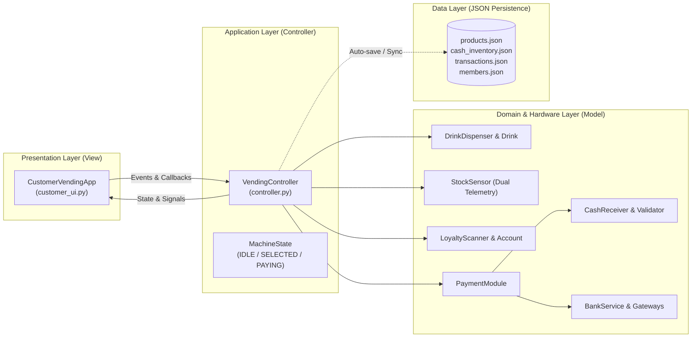

# 🥤 Edge Hill University — Smart Vending Machine System

[](https://www.python.org/)
[](https://docs.python.org/3/library/tkinter.html)
[](https://stripe.com)
[](#-system-architecture--how-it-works)
[](#-associated-documentation)

An accessible, robust, and touchscreen-optimised **Smart Vending Machine Software System** designed and developed for the **Software Engineering Group Assignment (CW1)** at **Edge Hill University**.

---

## 📌 สารบัญ (Table of Contents)
1. [📖 คำอธิบายโปรแกรม (Project Overview)](#-1-คำอธิบายโปรแกรม-project-overview)
2. [💻 ความต้องการของระบบ (System Requirements)](#-2-ความต้องการของระบบ-system-requirements)
3. [⚙️ ขั้นตอนการติดตั้ง (Installation & Setup)](#-3-ขั้นตอนการติดตั้ง-installation--setup)
4. [🧠 การทำงานของระบบ (System Architecture & Mechanics)](#-4-การทำงานของระบบ-system-architecture--mechanics)
   * [โครงสร้างสถาปัตยกรรม (MVC Architecture)](#41-โครงสร้างสถาปัตยกรรม-mvc-architecture)
   * [ระบบจัดการเงินสด & การทอนเงิน (Cash Acceptance & Greedy Change)](#42-ระบบจัดการเงินสด--การทอนเงิน-cash-acceptance--greedy-change)
   * [ระบบชำระเงินดิจิทัล & Stripe Dynamic QR](#43-ระบบชำระเงินดิจิทัล--stripe-dynamic-qr)
   * [ระบบบัตรสมาชิกนักศึกษา & ส่วนลด (Loyalty Programme)](#44-ระบบบัตรสมาชิกนักศึกษา--ส่วนลด-loyalty-programme)
   * [ระบบตรวจสอบสต็อกเซนเซอร์คู่ (Dual-Sensor Stock Telemetry)](#45-ระบบตรวจสอบสต็อกเซนเซอร์คู่-dual-sensor-stock-telemetry)
5. [🕹️ การใช้งานโปรแกรม (User & Admin Manual)](#-5-การใช้งานโปรแกรม-user--admin-manual)
   * [ขั้นตอนสำหรับลูกค้าทั่วไป (Customer Purchasing Workflow)](#51-ขั้นตอนสำหรับลูกค้าทั่วไป-customer-purchasing-workflow)
   * [ขั้นตอนสำหรับผู้ดูแลระบบ (Admin & Maintenance Dashboard)](#52-ขั้นตอนสำหรับผู้ดูแลระบบ-admin--maintenance-dashboard)
   * [ปุ่มลัดและการควบคุม (Keyboard Shortcuts & Navigation)](#53-ปุ่มลัดและการควบคุม-keyboard-shortcuts--navigation)
6. [🎨 ธีมสีและการออกแบบ (UI Design & Accessibility)](#-6-ธีมสีและการออกแบบ-ui-design--accessibility)
7. [📁 โครงสร้างโปรเจกต์ & ฐานข้อมูล JSON (Project Structure)](#-7-โครงสร้างโปรเจกต์--ฐานข้อมูล-json-project-structure)
8. [📄 เอกสารประกอบระบบ (Associated Documentation)](#-8-เอกสารประกอบระบบ-associated-documentation)

---

## 📖 1. คำอธิบายโปรแกรม (Project Overview)

ระบบ **Smart Vending Machine System** เป็นระบบซอฟต์แวร์จำลองตู้จำหน่ายเครื่องดื่มอัตโนมัติอัจฉริยะ ออกแบบมาเพื่อรองรับการใช้งานจริงในมหาวิทยาลัย Edge Hill University โดยผสานการทำงานระหว่างการสั่งซื้อผ่านหน้าจอสัมผัส (Touchscreen), การกดรหัสช่องผ่านแป้นพิมพ์ตัวเลข (Physical Numpad), ระบบสแกนบัตรนักศึกษาเพื่อรับส่วนลดสะสมแต้ม (Loyalty Discount 10%), และระบบชำระเงินแบบ Hybrid ที่รองรับทั้งเหรียญ/ธนบัตรจริง และการชำระผ่าน Dynamic QR Code (Stripe / PayPal / Mock Bank)

### 🌟 จุดเด่นของระบบ (Key Highlights):
* **Flicker-Free Modern GUI:** หน้าจอคมชัด Responsive ปรับขนาดตามความละเอียดหน้าจออัตโนมัติ (ขนาดย่อสุด 860x560) พร้อมแอนิเมชันกระป๋องตกและเสียงสังเคราะห์
* **Strict 5-Color Accessibility Theme:** ใช้พาเล็ตสีตามมาตรฐาน Contrast สูง 5 สีหลักตามอัตลักษณ์ของมหาวิทยาลัย
* **Dual-Sensor Telemetry:** จำลองระบบตรวจสอบสต็อกด้วยโหลดเซลล์ชั่งน้ำหนัก (Weight Sensor) ร่วมกับเซนเซอร์ลำแสงตรวจจับกระป๋อง (Optical Beam Sensor)
* **Greedy Coin Dispenser:** อัลกอริทึมคำนวณเงินทอนอัตโนมัติ พร้อมตรวจนับคลังเหรียญในตู้แบบเรียลไทม์
* **Dynamic Payment Gateway Engine:** สลับระหว่าง Stripe Dynamic QR (สร้าง QR จาก PaymentIntent/Checkout API แบบเรียลไทม์), PayPal REST, Custom REST, และ Mock Bank สำหรับการทดสอบออฟไลน์
* **Interactive Maintenance Dashboard:** แผงควบคุมช่างเทคนิค 6 แท็บ พร้อม Live Telemetry Sidebar แสดงสถานะระบบสด 8 ค่า

---

## 💻 2. ความต้องการของระบบ (System Requirements)

### ข้อกำหนดด้านฮาร์ดแวร์ (Hardware Requirements):
* **หน่วยประมวลผล (CPU):** 1.6 GHz Dual-Core หรือสูงกว่า (รองรับสถาปัตยกรรม Intel x86_64, AMD64, และ Apple Silicon M-Series)
* **หน่วยความจำ (RAM):** ขั้นต่ำ 2 GB (แนะนำ 4 GB ขึ้นไป)
* **พื้นที่ว่างบนฮาร์ดดิสก์:** ขั้นต่ำ 250 MB
* **จอแสดงผล (Display):** ความละเอียดขั้นต่ำ 1024 x 768 (แนะนำ Full HD 1920 x 1080 ขึ้นไป)
* **กล้องเว็บแคม (Optional):** กล้องความละเอียด 720p ขึ้นไป (สำหรับทดสอบระบบกล้องสแกน Barcode/QR Code สด)

### ข้อกำหนดด้านซอฟต์แวร์ (Software Requirements):
* **ระบบปฏิบัติการ (Operating System):**
  * macOS (Darwin 11.0 Big Sur หรือใหม่กว่า)
  * Linux (Ubuntu 20.04 LTS+, Debian, Fedora)
  * Microsoft Windows 10 / 11 (64-bit)
* **Python Runtime:** Python **3.9** ขึ้นไป (ผ่านการทดสอบและรองรับ Python **3.14**)
* **Tkinter Framework:** ติดตั้งมาพร้อมกับ Python มาตรฐาน

### ไลบรารีที่จำเป็น (Python Dependencies):
| แพ็กเกจ (Package) | เวอร์ชันขั้นต่ำ | วัตถุประสงค์การใช้งาน |
| :--- | :--- | :--- |
| **`Pillow`** | `>= 9.0.0` | ประมวลผลและปรับขนาดรูปภาพเครื่องดื่ม High-Resolution และโลโก้ |
| **`opencv-python`** | `>= 4.5.0` | จัดการสัญญาณกล้องเว็บแคม และสร้าง Dynamic QR Code (`QRCodeEncoder`) |
| **`pyzbar`** | `>= 0.1.8` | สแกนและถอดรหัสบาร์โค้ดบัตรนักศึกษา/อาจารย์จากภาพกล้อง |
| **`numpy`** | `>= 1.20.0` | จัดการ Matrix สำหรับงานประมวลผลภาพ QR Code และการสเกลพิกเซล |
| **`stripe`** | `>= 2.60.0` | เชื่อมต่อ Stripe Payments API (Checkout Sessions & Dynamic QR) |

---

## ⚙️ 3. ขั้นตอนการติดตั้ง (Installation & Setup)

### 3.1 การโคลนโปรเจกต์ (Clone Repository)
เปิด Terminal หรือ Command Prompt แล้วไปยังโฟลเดอร์ที่ต้องการ:
```bash
cd "CW1_Group_Assignment/VendingMachine"
```

### 3.2 การสร้าง Virtual Environment (แนะนำ)
เพื่อป้องกันการชนกันของเวอร์ชันไลบรารีในระบบ:

* **บน macOS / Linux:**
  ```bash
  python3 -m venv venv
  source venv/bin/activate
  ```
* **บน Windows:**
  ```cmd
  python -m venv venv
  venv\Scripts\activate
  ```

### 3.3 การติดตั้ง Dependencies
ติดตั้งแพ็กเกจทั้งหมดผ่านไฟล์ `requirements.txt`:
```bash
pip install -r requirements.txt
```

> [!TIP]
> ตัวโปรแกรมมีระบบ **Auto-Dependency Verification** ในไฟล์ `main.py` หากรันโปรแกรมแล้วตรวจพบว่าขาดไลบรารีใด ระบบจะพยายามดาวน์โหลดและติดตั้งให้อัตโนมัติก่อนเริ่มเปิดหน้าต่าง GUI

### 3.4 การเปิดใช้งานโปรแกรม (Launch Application)
รันไฟล์ Entry Point หลัก:
```bash
python3 main.py
```

---

## 🧠 4. การทำงานของระบบ (System Architecture & Mechanics)

### 4.1 โครงสร้างสถาปัตยกรรม (MVC Architecture)
ระบบถูกออกแบบด้วยสถาปัตยกรรม **Model-View-Controller (MVC)** อย่างเคร่งครัดตามหลักการ Separation of Concerns (SoC):



* **Presentation Layer (`src/views/`):** จัดการเรนเดอร์หน้าจอ GUI 4 หน้าหลัก (`catalogue`, `payment`, `success`, `cancelled`), แป้นพิมพ์ Numpad, การแสดงผลบาร์โค้ด และแผงควบคุม Options
* **Controller Layer (`src/controllers/`):** ควบคุม State Machine (`MachineState`), รับส่งข้อมูลระหว่าง View และ Model, จัดการ Transaction Timer (นับถอยหลัง 60 วินาที) และสั่งบันทึกประวัติการขาย
* **Domain Layer (`src/models/`):** จัดการกฎเกณฑ์ทางธุรกิจ (Business Rules), คลังสินค้า (`DrinkDispenser`), เซนเซอร์จำลอง (`StockSensor`), ระบบรับเงินสด (`CashReceiver`), และระบบธนาคาร (`BankService`)
* **Persistence Layer (`data/`):** จัดเก็บข้อมูลในรูปแบบไฟล์ JSON โครงสร้างมาตรฐาน ทำให้ระบบทำงานได้แบบ Standalone โดยไม่ต้องติดตั้งฐานข้อมูล SQL ภายนอก

---

### 4.2 ระบบจัดการเงินสด & การทอนเงิน (Cash Acceptance & Greedy Change)
ระบบมี **`CashValidator`** ทำหน้าที่ตรวจสอบและคัดกรองเงินสดที่หยอดเข้าตู้:
* **สกุลเงินที่ยอมรับ (Accepted Denominations):**
  * เหรียญ: `10p`, `20p`, `50p`, `£1.00 (100p)`, `£2.00 (200p)`
  * ธนบัตร: `£5.00 Note (500p)`, `£10.00 Note (1000p)`
* **นโยบายการปฏิเสธ (Rejection Policy):**
  * เหรียญต่ำกว่า 10p (`1p`, `2p`, `5p`) และธนบัตรมูลค่าสูง (`£20.00`, `£50.00`) จะถูกปฏิเสธทันที และดีดคืนออกทางช่องรับเงินทอนโดยยอดเงินไม่ถูกบวกเพิ่ม
* **Greedy Coin Dispenser Algorithm:**
  เมื่อลูกค้าชำระเงินเกิน ระบบจะคำนวณเงินทอนโดยเรียงลำดับเหรียญมูลค่าสูงสุดลงไปหาต่ำสุด (`£2.00` ➔ `£1.00` ➔ `50p` ➔ `20p` ➔ `10p`) โดยหักจำนวนเหรียญออกจากคลังเหรียญในตู้ (`cash_inventory.json`) จริง

---

### 4.3 ระบบชำระเงินดิจิทัล & Stripe Dynamic QR
เมื่อลูกค้าเลือกจ่ายด้วยบัตรหรือคิวอาร์โค้ด:
1. `CardReader` จะเรียก `BankService.createCheckoutSession()` ไปยัง Payment Gateway ที่กำลังใช้งาน
2. **Stripe Gateway:** ส่งคำขอสร้าง Hosted Checkout Session ผ่าน HTTPS REST ไปยัง Stripe API (`api.stripe.com/v1`)
3. ระบบจะนำ `checkout_url` ที่ได้รับมาแปลงเป็นภาพ Dynamic QR Code ด้วยโมดูล `cv2.QRCodeEncoder` หรือ `qrcode` แล้วแสดงบนหน้าจอทันที
4. ระบบเปิด **Background Polling Thread** คอยตรวจเช็กสถานะการจ่ายเงินทุกๆ 1.5 วินาที
5. หากลูกค้าสแกนจ่ายเงินสำเร็จ ระบบจะตัดยอดและจ่ายเครื่องดื่มทันที
6. หากครบกำหนด 60 วินาที หรือลูกค้ากดยกเลิก ระบบจะส่งคำขอ `expireCheckoutSession()` ไปยัง Stripe เพื่อยกเลิกเซสชันทันที ป้องกันการถูกสแกนจ่ายย้อนหลัง

---

### 4.4 ระบบบัตรสมาชิกนักศึกษา & ส่วนลด (Loyalty Programme)
* บัตรนักศึกษาและอาจารย์ (Student & Staff Cards) ถูกจัดเก็บใน `data/members.json`
* เมื่อสแกนบัตรผ่านกล้องหรือกรอกรหัสบัตร (เช่น `247480103B001`) ระบบจะตรวจสอบผ่าน `LoyaltyScanner.scan()`
* บัตรที่ถูกต้องและมีสถานะ `active: true` จะได้รับ**ส่วนลด 10% ทันที** (สูตรคำนวณ: `amountDue = listPrice * 0.90`)
* ระบบมีระบบป้องกันการสแกนซ้ำ (Idempotency Guard) เพื่อไม่ให้เกิดการลดราคาซ้ำซ้อนในรายการเดียวกัน

---

### 4.5 ระบบตรวจสอบสต็อกเซนเซอร์คู่ (Dual-Sensor Stock Telemetry)
เพื่อความสมจริงในเชิงวิศวกรรม ระบบจำลองฮาร์ดแวร์ตรวจสอบสต็อกแบบ 2 ทาง (Dual-Sensor Cross-Verification):
1. **Load Cell (Weight Scale):** ชั่งน้ำหนักรวมบนถาดของแถวนั้นๆ (สูตร: `(stock * unit_weight) + tare_weight`)
2. **Optical Beam / Proximity Sensor:** เซนเซอร์ลำแสงตรวจนับจำนวนกระป๋องจริงทางกายภาพ
3. ระบบจะทำการ Cross-Check หากค่าน้ำหนักไม่สอดคล้องกับจำนวนกระป๋อง (เช่น มีสิ่งแปลกปลอมตกใส่ถาด) ระบบจะส่งสัญญาณเตือน `DISCREPANCY_ALERT` ในแถบ Telemetry ทันที

---

## 🕹️ 5. การใช้งานโปรแกรม (User & Admin Manual)

### 5.1 ขั้นตอนสำหรับลูกค้าทั่วไป (Customer Purchasing Workflow)

```
[หน้า 1: เลือกสินค้า] ──► [สแกนบัตรลด 10%] ──► [เลือกวิธีชำระเงิน] ──► [รับเครื่องดื่ม]
```

1. **เลือกเครื่องดื่ม (Page 1):**
   * คลิกที่การ์ดสินค้าบนหน้าจอ หรือกดปุ่มหมวดหมู่ด้านบน (Coffee, Chocolate & Tea, Cold Drinks)
   * หรือใช้แป้น Numpad กดรหัสช่อง 2 หลัก (เช่น `0`, `1` สำหรับ Espresso หรือ `0`, `2` สำหรับ Latte)
   * เมื่อรหัสถูกต้อง กรอบสินค้าจะสว่างเป็นสีเขียวมะนาว (Electric Lime) พร้อมรูปและข้อมูลสินค้า
   * กดปุ่ม **"Proceed to Payment"** เพื่อไปหน้าถัดไป
2. **สแกนบัตรสะสมแต้ม (Page 2 - Optional):**
   * ลูกค้าที่มีบัตรนักศึกษาสามารถเปิดกล้องกด **"Turn On Camera"** เพื่อสแกนบาร์โค้ด หรือกรอกรหัสบัตรในช่อง Manual Entry
   * ยอดเงินที่ต้องชำระจะลดลง 10% อัตโนมัติ
3. **เลือกช่องทางชำระเงิน (Page 2):**
   * **ชำระด้วยเงินสด (Cash):** คลิกปุ่มจำลองการหยอดเหรียญ/ธนบัตร (10p, 20p, 50p, £1, £2, £5, £10) ยอดเงินที่หยอดจะสะสมจนครบ ยอดเงินทอนจะแสดงขึ้นมา
   * **ชำระด้วยบัตร / สแกน QR (Card/Stripe):** หน้าจอจะแสดง Dynamic QR Code ให้ใช้มือถือสแกนจ่ายเงิน หรือกดปุ่ม "Simulate Bank Approval" เพื่อจำลองการอนุมัติ
4. **รับสินค้า (Page 3):**
   * เมื่อชำระเงินสำเร็จ ระบบจะแสดงหน้าจอ Dispense Animation เครื่องดื่มกระป๋องจะเลื่อนลงมา พร้อมเสียงสัญญาณ Chime และสรุปเงินทอนที่ได้รับ
   * เครื่องจะรีเซ็ตกลับสู่หน้าแรกอัตโนมัติภายใน 10 วินาที

---

### 5.2 ขั้นตอนสำหรับผู้ดูแลระบบ (Admin & Maintenance Dashboard)
กดปุ่ม **"⚙️ Options"** ที่มุมขวาบนของหน้าจอหลัก เพื่อเปิดแผงควบคุมระบบ (มีแถบ **Live System Summary Sidebar** แสดงสถานะสด 8 ค่าตลอดเวลา):

* **แท็บ 1: Products Catalogue (จัดการสินค้า & สต็อก)**
  * แก้ไขชื่อสินค้า, ราคา (หน่วย pence), หมวดหมู่ และช่อง Slot
  * ปุ่ม **"Restock All Slots (+10)"** สำหรับเติมสินค้าทุกช่องให้เต็ม 10 กระป๋อง พร้อมปรับเทียบเซนเซอร์ชั่งน้ำหนักใหม่
* **แท็บ 2: Cash Vault (คลังเงินสดและเงินทอน)**
  * ดูจำนวนเหรียญและธนบัตรคงเหลือแต่ละชนิดในตู้
  * ปุ่ม **"Refill All Denominations"** สำหรับเติมเหรียญสำรองทอนเงินให้เต็ม
* **แท็บ 3: Payment Configuration (ตั้งค่าเกตเวย์)**
  * สวิตช์เปิด/ปิด การรับเงินสด หรือบัตรเครดิต
  * สลับ Gateway ใช้งานจริง: **Stripe**, **PayPal REST**, **Custom REST**, หรือ **Mock Bank**
  * ปุ่ม **"Test Connection"** สำหรับทดสอบสัญญาณเชื่อมต่อ API ของเกตเวย์
  * ปรับเวลา Timeout ของการทำรายการ (5 ถึง 300 วินาที)
* **แท็บ 4: Transactions History (ประวัติการขาย)**
  * ดูรายการใบเสร็จการสั่งซื้อย้อนหลังทั้งหมด พร้อมวันเวลา สถานะ (`SUCCESS`, `CANCELLED`, `TIMEOUT`)
* **แท็บ 5: Loyalty Members (จัดการสมาชิก)**
  * เพิ่มสมาชิกรหัสนักศึกษาใหม่, สลับสถานะบัตร (Active / Inactive), หรือลบสมาชิก
* **แท็บ 6: System Activity Logs (บันทึกการทำงานของระบบ)**
  * บันทึก Audit Log เหตุการณ์เชิงเทคนิคทั้งหมดของฮาร์ดแวร์และคอนโทรลเลอร์

---

### 5.3 ปุ่มลัดและการควบคุม (Keyboard Shortcuts & Navigation)
ระบบรองรับการควบคุมผ่านคีย์บอร์ดและเมาส์เต็มรูปแบบ:
* **`0` – `9`:** กรอกรหัสช่องตู้สินค้า 2 หลัก
* **`Backspace`:** ล้างรหัสช่องที่กรอกผิด หรือย้อนกลับ
* **`Enter` / `Return`:** ยืนยันการเลือกสินค้าเข้าสู่หน้าชำระเงิน
* **`Escape (Esc)`:** ยกเลิกรายการสั่งซื้อและขอเงินคืนทันที
* **`Trackpad / MouseWheel Scroll`:** เลื่อนดูเนื้อหาในหน้าชำระเงิน (Page 2) และหน้าตั้งค่า Payment Methods (Tab 3) ได้อย่างลื่นไหล
* **`PageUp` / `PageDown`:** เลื่อนหน้าจอขึ้น/ลงอย่างรวดเร็ว

---

## 🎨 6. ธีมสีและการออกแบบ (UI Design & Accessibility)

ระบบเลือกใช้ชุดสีตามมาตรฐาน Contrast สูงระดับสากล จำนวน 5 สีหลัก:

| รหัสสี (Hex Code) | ชื่อสี (Color Name) | ตัวอย่างสี | วัตถุประสงค์การใช้งานใน UI |
| :---: | :--- | :---: | :--- |
| **`#3A0C51`** | **Deep Aubergine Purple** | 🟣 | สีพื้นหลังหลักของตู้, ขอบหน้าต่าง, ส่วนหัว (Header) และการ์ดสินค้า |
| **`#BAEF2D`** | **Electric Lime Green** | 🟢 | สีปุ่ม Call-to-Action หลัก, ป้ายราคา, การ์ดที่ถูกเลือก, สถานะสำเร็จ |
| **`#FFFFFF`** | **Pure White** | ⚪ | ข้อความหัวข้อหลัก, พื้นหลัง Modal, คอนทราสต์สูงสำหรับอ่านง่าย |
| **`#D883FF`** | **Bright Lavender Lilac** | 🟪 | เส้นแบ่งส่วนประกอบ, สีข้อความรอง, แถบสถานะย่อย |
| **`#12372E`** | **Deep Forest Green** | 🌲 | พื้นหลังหน้าจอดิจิทัล (Terminal Display) และปุ่มกดตัวเลข Numpad |

---

## 📁 7. โครงสร้างโปรเจกต์ & ฐานข้อมูล JSON (Project Structure)

```text
VendingMachine/
├── main.py                     # Entry point หลักของระบบ (มีระบบตรวจสอบ dependency อัตโนมัติ)
├── requirements.txt            # รายการไลบรารีภายนอกที่ต้องติดตั้ง
├── README.md                   # เอกสารคู่มือระบบฉบับสมบูรณ์
│
├── src/                        # ซอร์สโค้ดหลักของโปรแกรม
│   ├── controllers/            # [Controller Layer] State Machine & จัดการการไหลของข้อมูล
│   │   ├── __init__.py
│   │   └── controller.py       # VendingController & ตัวเชื่อมต่อฐานข้อมูล JSON
│   │
│   ├── models/                 # [Domain Layer] Business Logic & ฮาร์ดแวร์จำลอง
│   │   ├── __init__.py
│   │   ├── inventory.py        # Drink, DrinkDispenser, StockSensor, LoyaltyAccount, LoyaltyScanner
│   │   ├── payment.py          # PaymentModule, CashReceiver, CashValidator, ChangeDispenser, CardReader
│   │   └── bank.py             # BankService Interface, MockBankService
│   │
│   ├── views/                  # [Presentation Layer] User Interface & กล้องสแกน
│   │   ├── __init__.py
│   │   └── customer_ui.py      # Tkinter GUI (Page 1-4, Numpad, Options Dashboard)
│   │
│   └── utils/                  # [Cross-Cutting Layer] ยูทิลิตี้เสริม
│       ├── __init__.py
│       ├── timer.py            # TransactionTimer (ระบบนับถอยหลัง & ตรวจสอบหมดเวลา)
│       └── logger.py           # Logger & TransactionRecord (บันทึกประวัติการขาย)
│
├── data/                       # [Persistence Layer] ฐานข้อมูลไฟล์ JSON
│   ├── activity_log.json       # บันทึกประวัติเหตุการณ์ของระบบ (Audit Trail)
│   ├── cash_inventory.json     # สต็อกเหรียญและธนบัตรคงเหลือในตู้
│   ├── members.json            # รายชื่อสมาชิกรหัสนักศึกษา/อาจารย์และสถานะบัตร
│   ├── payment_config.json     # ค่าคอนฟิกเกตเวย์ชำระเงิน และสวิตช์เปิด/ปิด
│   ├── products.json           # แคตตาล็อกเครื่องดื่ม ราคา สต็อก และน้ำหนัก
│   └── transactions.json       # ประวัติใบเสร็จการขายทั้งหมด
│
└── assets/                     # [Static Assets] รูปภาพสินค้าความละเอียดสูงและโลโก้
    ├── edge_hill_logo.png      # ตราสัญลักษณ์มหาวิทยาลัย Edge Hill
    └── *.jpg / *.png / *.avif  # รูปภาพเครื่องดื่มประจำตู้
```

---

## 📄 8. เอกสารประกอบระบบ (Associated Documentation)

เอกสารการวิเคราะห์และออกแบบระบบเชิงวิศวกรรมซอฟต์แวร์ (OOAD) เพิ่มเติม:
* **UML Diagrams:** [uml-diagrams.md](file:///Users/chatchawanjiamprasut/.gemini/antigravity/brain/13fa5075-f274-4566-ad65-387b625d3b6f/uml-diagrams.md) — แผนภาพ Class Diagram ฉบับเต็ม, Sequence Diagrams 2 รูปแบบ, State Machine และ Package Diagram
* **System Flowcharts:** [system-flowcharts.md](file:///Users/chatchawanjiamprasut/.gemini/antigravity/brain/13fa5075-f274-4566-ad65-387b625d3b6f/system-flowcharts.md) — แผนภาพการไหลของระบบ 4 กระบวนการหลัก
* **Software Test Plan:** [Software_Test_Plan_Smart_Vending_Machine.docx](file:///Users/chatchawanjiamprasut/Desktop/Year%203/Software%20Engineering/CW1_Group_Assignment/VendingMachine/Software_Test_Plan_Smart_Vending_Machine.docx) — เอกสารแผนการทดสอบระบบมาตรฐาน IEEE 829 ในรูปแบบไฟล์ Microsoft Word

---

## 👥 9. ผู้จัดทำ (Project Credits & Team)
* **Institution:** Edge Hill University — Department of Computer Science
* **Course:** Software Engineering (Year 3) — Group Assignment (CW1)
* **Academic Year:** 2026
