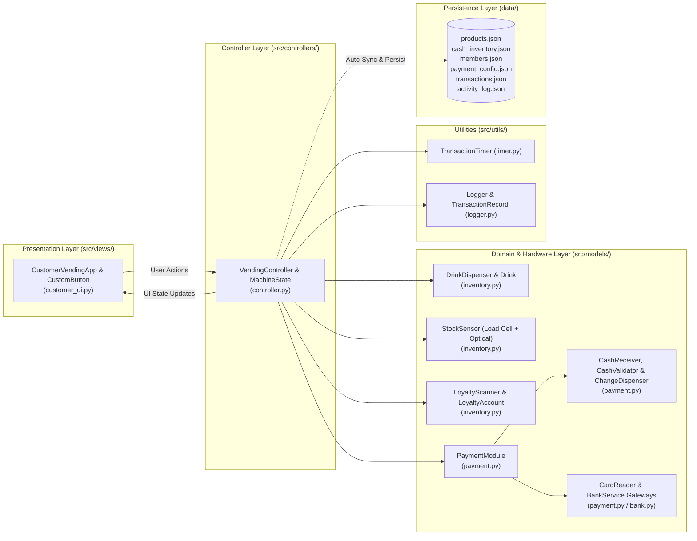

# 🥤 Edge Hill University — Smart Vending Machine System

[](https://www.python.org/)
[](https://docs.python.org/3/library/tkinter.html)
[](https://stripe.com)
[](#-4-system-architecture--core-subsystems)
[](#-8-uml-diagrams--testing-artifacts)

An accessible, high-contrast, and hardware-emulated **Smart Vending Machine Software System** designed and engineered for the **CIS2722 Software Engineering Group Assignment (CW1)** at **Edge Hill University**.

---

## 📌 Table of Contents
1. [📖 Project Overview](#-1-project-overview)
2. [💻 System Requirements & Dependencies](#-2-system-requirements--dependencies)
3. [⚙️ Installation & Quick Start](#-3-installation--quick-start)
4. [🧠 System Architecture & Core Subsystems](#-4-system-architecture--core-subsystems)
   * [4.1 MVC & Two-Subsystem Distributed Design](#41-mvc--two-subsystem-distributed-design)
   * [4.2 Cash Handling, Greedy Change & Insufficient-Change Protection](#42-cash-handling-greedy-change--insufficient-change-protection)
   * [4.3 Digital Card & Stripe Dynamic QR Gateway](#43-digital-card--stripe-dynamic-qr-gateway)
   * [4.4 Student & Staff Loyalty Programme](#44-student--staff-loyalty-programme)
   * [4.5 Dual-Sensor Inventory Telemetry](#45-dual-sensor-inventory-telemetry)
5. [🕹️ User & Administrator Guide](#-5-user--administrator-guide)
   * [5.1 Customer Purchasing Workflow (Step-by-Step)](#51-customer-purchasing-workflow-step-by-step)
   * [5.2 Complete Keyboard Shortcuts Reference](#52-complete-keyboard-shortcuts-reference)
   * [5.3 Admin & Maintenance Dashboard](#53-admin--maintenance-dashboard)
6. [🎨 UI Design & Accessibility (Strict 5-Color Theme)](#-6-ui-design--accessibility-strict-5-color-theme)
7. [📁 Project Structure & JSON Databases](#-7-project-structure--json-databases)
8. [📐 UML Diagrams & Testing Artifacts](#-8-uml-diagrams--testing-artifacts)
9. [👥 Project Credits & License](#-9-project-credits--license)

---

## 📖 1. Project Overview

The **Smart Vending Machine System** simulates an interactive campus beverage kiosk developed for Edge Hill University. It implements all **15 Core Functions**, **6 Optional Extension Components**, and **4 Mandatory Error Conditions** defined in the CIS2722 specification:

* **4 Fixed Scenario Beverages:**
  * **Slot 1 — Espresso:** `£1.50` (`150p`) | Loyalty Price (10% off): `£1.35` (`135p`)
  * **Slot 2 — Caffe Latte:** `£2.20` (`220p`) | Loyalty Price (10% off): `£1.98` (`198p`)
  * **Slot 3 — Hot Chocolate:** `£2.00` (`200p`) | Loyalty Price (10% off): `£1.80` (`180p`)
  * **Slot 4 — Bottled Water:** `£1.00` (`100p`) | Loyalty Price (10% off): `£0.90` (`90p`)
* **4 Mandatory Error / Edge Conditions Handled:**
  1. **Drink Out of Stock:** Displays an out-of-stock alert and prevents proceeding to payment.
  2. **Card Payment Declined:** `BankService` declines authorization; transaction is cancelled safely without dispensing.
  3. **Insufficient Cash / Transaction Timeout:** Automatic countdown timer (`TransactionTimer`, default 60s) cancels the transaction on expiry and refunds 100% of inserted cash.
  4. **Customer Cancels & Insufficient Change Protection:** Customers can cancel at any stage (`[ Backspace ]` / `[ Esc ]`) for a full immediate refund. Additionally, if the coin hopper lacks sufficient coins to dispense exact change on an overpayment, the order is automatically cancelled and all inserted money is returned with the reason `"Change is not sufficient"`.

---

## 💻 2. System Requirements & Dependencies

### Hardware Specifications
* **Processor (CPU):** 1.6 GHz Dual-Core or faster (x86_64, AMD64, or Apple Silicon M-Series).
* **System Memory (RAM):** 2 GB minimum (4 GB+ recommended).
* **Storage Capacity:** Minimum 250 MB free disk space.
* **Display Resolution:** Minimum `1100 x 750` (Full HD `1920 x 1080` recommended).
* **Integrated / USB Webcam (Optional):** 720p or higher (used for live Code 128 loyalty card barcode scanning on Step 2).

### Software Specifications
* **Operating Systems:** macOS (Big Sur 11.0+), Linux (Ubuntu 20.04 LTS+, Debian 11+, Fedora 36+), Windows 10 / 11 (64-bit).
* **Python Runtime:** Python **3.9** or higher (verified up to Python **3.14**).
* **GUI Toolkit:** Standard `tkinter` / `ttk` library included with official Python installations.

### Python Package Dependencies (`requirements.txt`)
| Package | Version | Functional Purpose |
| :--- | :--- | :--- |
| **`Pillow`** | `>= 9.0.0` | High-resolution product image rendering, scaling, and canvas artwork. |
| **`opencv-python`** | `>= 4.5.0` | Live webcam video capture, Code 128 barcode detection, and QR code matrix encoding. |
| **`pyzbar`** | `>= 0.1.8` | Optical barcode and QR decoding support (`zxing-cpp` also supported if installed). |
| **`numpy`** | `>= 1.20.0` | Frame matrix manipulation, cropping, and QR quiet-zone padding. |
| **`stripe`** | `>= 2.60.0` | Stripe Checkout Session creation, PaymentIntent validation, and live status polling. |

---

## ⚙️ 3. Installation & Quick Start

### 3.1 Clone the Repository
```bash
git clone https://github.com/basschatchawan13327/VendingMachine.git
cd VendingMachine
```

### 3.2 Create & Activate a Virtual Environment (Recommended)
* **macOS / Linux:**
  ```bash
  python3 -m venv venv
  source venv/bin/activate
  ```
* **Windows:**
  ```cmd
  python -m venv venv
  venv\Scripts\activate
  ```

### 3.3 Install Dependencies
```bash
pip install -r requirements.txt
```
> [!TIP]
> `main.py` includes an automatic dependency checker (`check_and_install_dependencies`). If any package in `requirements.txt` is missing at startup, `main.py` automatically invokes `pip install` before launching the GUI.

### 3.4 Launch the Application
```bash
python3 main.py
```

---

## 🧠 4. System Architecture & Core Subsystems

### 4.1 MVC & Two-Subsystem Distributed Design
The application follows a strict **Model-View-Controller (MVC)** architecture divided into two coordinated operational subsystems:
* **Sub-system 1 (Vending Machine & Cash Control):** Manages slot availability (`DrinkDispenser`, `StockSensor`), coin/note validation (`CashValidator`), cash accumulation (`CashReceiver`), and coin float change calculation (`ChangeDispenser`).
* **Sub-system 2 (Card Operations & External Banking):** Manages card/QR checkout sessions (`CardReader`) and communicates with external banking gateways (`BankService` $\rightarrow$ `StripeBankService`, `PayPalBankService`, `CustomRestBankService`, `MockBankService`).



---

### 4.2 Cash Handling, Greedy Change & Insufficient-Change Protection
* **Accepted Denominations (`10p` to `£10.00`):**
  * **UK Coins:** `10p`, `20p`, `50p`, `£1.00 (100p)`, `£2.00 (200p)`
  * **UK Banknotes:** `£5.00 Note (500p)`, `£10.00 Note (1000p)`
* **Denomination Rejection Policy:**
  * Coins below 10p (`1p`, `2p`, `5p`) and high-value banknotes (`£20.00`, `£50.00`) are rejected by `CashValidator` and immediately returned to the customer without increasing the inserted total.
* **Greedy Change Algorithm & Real-Time Vault Persistence:**
  * On overpayment, `ChangeDispenser` uses a greedy algorithm across available coin denominations (`200p` $\rightarrow$ `100p` $\rightarrow$ `50p` $\rightarrow$ `20p` $\rightarrow$ `10p`).
  * After every completed cash sale, `VendingController._updateCashInventoryOnSale()` automatically increments the inserted coins/banknotes, deducts the dispensed change coins, recalculates the vault totals, and saves to `data/cash_inventory.json`.
* **Insufficient Change Cancellation Guard:**
  * If `ChangeDispenser.canMakeChange(overpaid)` determines that exact change cannot be made from the current coin hopper inventory, `CashReceiver` immediately transitions to `REFUNDING`, returns 100% of the inserted cash, cancels the order, and displays `"Order Cancelled: Change is not sufficient!"`.

---

### 4.3 Digital Card & Stripe Dynamic QR Gateway
1. When the customer chooses Card / QR payment, `CardReader` requests a checkout session from the configured `BankService`.
2. **Stripe Dynamic QR:** Creates a live Stripe Checkout Session (`api.stripe.com/v1/checkout/sessions`) and renders a scannable QR code on screen.
3. A background polling loop checks `checkCheckoutSessionStatus()` every 1.5 seconds and automatically completes the sale upon confirmation.
4. Supports instant simulation and declined-card testing (`MockBankService` / test buttons) to verify Error Condition 2.

---

### 4.4 Student & Staff Loyalty Programme
* Member accounts are stored in `data/members.json` and validated by `LoyaltyScanner`.
* Scanning a valid, active Code 128 loyalty card applies a **10% discount** prior to payment:
  $$\text{Amount Due} = \text{List Price} - \lfloor \text{List Price} \times 0.10 \rfloor$$
* **Distinct Status Notifications:**
  * **Valid Active Card:** Displays `"🎉 Card Verified: <Member Name> — 10% Discount Applied!"` and auto-advances to Step 3.
  * **Inactive Card:** Displays `"⛔ Card '<ID>' is inactive. Try another card or press [ Enter ] to skip."` while keeping the camera stream active so another card can be scanned.
  * **Unrecognised Card:** Displays `"❌ Card '<ID>' is unrecognised. Try again or press [ Enter ] to skip."` while keeping the camera stream active.

---

### 4.5 Dual-Sensor Inventory Telemetry
`StockSensor` emulates physical vending machine hardware per slot:
1. **Load Cell Weight Sensor:** Computes expected tray weight in grams:
   $$\text{Expected Weight} = (\text{Stock Count} \times \text{Unit Weight}) + \text{Tare Weight}$$
2. **Optical Beam Sensor:** Counts physical units in the slot channel.
3. Cross-verification flags `OK`, `WEIGHT_VARIANCE`, or `DISCREPANCY_ALERT` when weight-derived stock diverges from the optical sensor count.

---

## 🕹️ 5. User & Administrator Guide

### 5.1 Customer Purchasing Workflow (Step-by-Step)

```text
[Step 1: Select Drink] ──► [Step 2: Loyalty Card Scan] ──► [Step 3: Payment Method] ──► [Dispense / Receipt]
```

1. **Step 1 of 3 — Select Your Drink (Catalogue Screen):**
   * Type a slot number (`1`–`4`) on your physical keyboard. The digital LCD screen and item preview box update immediately, highlighting the selected drink card.
   * Press **`[ Enter ]`** (or click **`✅ Confirm Selection [ Enter ]`**) to confirm, or press **`[ Backspace ]`** to clear.
2. **Step 2 of 3 — Scan Loyalty Card (10% Discount):**
   * Hold a Code 128 loyalty barcode inside the green camera guide box for an instant 10% discount.
   * Or press **`[ Enter ]`** (`⏭️ Skip Loyalty Card [ Enter ]`) to proceed at regular price, or **`[ Backspace ]`** / **`[ Esc ]`** to cancel the order.
3. **Step 3 of 3 — Select Payment Method:**
   * Review the **Order Summary** and **Member Profile** in the left sidebar (or click **`❌ Cancel Order / Change Drink [ Backspace ]`** at the bottom of the sidebar).
   * Press **`[ 1 ]`** (or click **`Pay with Cash`**) to open the Cash Payment Terminal, then press keys **`1`–`7`** (or click the denomination buttons) to insert `10p` to `£10.00` (keys `8` and `9` test rejected `£20` and `£50` notes).
   * Press **`[ 2 ]`** (or click **`Pay with Card / QR`**) to open the Card / Stripe QR Payment Terminal.
4. **Dispensing & Completion / Cancellation Screens:**
   * On successful payment, the machine dispenses the drink, updates `products.json`, `cash_inventory.json`, `transactions.json`, and `activity_log.json`, and displays the **Payment Successful** screen (auto-returning to the catalogue after 10 seconds, or immediately via **`[ Enter ]`**).

---

### 5.2 Complete Keyboard Shortcuts Reference

| Screen / Modal | Key | Action |
| :--- | :---: | :--- |
| **Global (Any Screen)** | `Esc` | Cancel current active transaction/dialog and return to Catalogue (with full refund) |
| **Step 1: Catalogue** | `1` – `4` | Enter drink slot number into the Selection Console |
| **Step 1: Catalogue** | `Enter` | Confirm selected drink and proceed to Step 2 (Loyalty Scan) |
| **Step 1: Catalogue** | `Backspace` | Clear entered slot selection |
| **Step 2: Loyalty Scan** | `Enter` | Skip loyalty card scan (or continue after verified scan) to Step 3 |
| **Step 2: Loyalty Scan** | `Backspace` | Cancel order and return to Step 1 (Catalogue) |
| **Step 3: Payment Method** | `1` | Open Cash Payment Terminal |
| **Step 3: Payment Method** | `2` | Open Card / Stripe QR Payment Terminal |
| **Step 3: Payment Method** | `Backspace` | Cancel order / change drink and return to Step 1 |
| **Cash Payment Modal** | `1` – `7` | Insert accepted cash (`1`=10p, `2`=20p, `3`=50p, `4`=£1, `5`=£2, `6`=£5, `7`=£10) |
| **Cash Payment Modal** | `8` – `9` | Test rejected banknotes (`8`=£20 Note, `9`=£50 Note) |
| **Cash Payment Modal** | `Backspace` | Cancel cash payment and refund all inserted money |
| **Card / QR Payment Modal** | `1` / `Enter` | Simulate Card Payment / Retry Stripe Connection |
| **Card / QR Payment Modal** | `Backspace` | Cancel card transaction |
| **Success / Cancelled Page** | `Enter` | Return immediately to Catalogue (skips 10s countdown) |

---

### 5.3 Admin & Maintenance Dashboard
Click the **`⚙️ Options`** button in the top header bar to open the 6-tab Maintenance Dashboard (equipped with a real-time **Live System Summary Sidebar**):

1. **📦 Products & Stock:** Add, edit, or delete products; update prices, stock counts, and load-cell weights; restock individual items or click **`Restock All Slots (+10)`**.
2. **💵 Cash & Coins:**
   * Inspect live hopper coin quantities (`10p`–`£2.00`) and stacker banknote quantities (`£5.00`, `£10.00`).
   * **Edit Cash / Coin Quantity:** Select any coin or banknote from the dropdown (or click any row in the table), enter a new integer quantity in the **`Quantity`** field, and click **`💾 Update Quantity`** to immediately update both `data/cash_inventory.json` and the active `ChangeDispenser`.
   * Click **`💰 Refill Coin Float (+20 of Each Coin)`** to bulk-replenish all coin hoppers, or test denominations using the **CashValidator** input box.
3. **💳 Payment Methods:** Enable/disable Cash or Card payments, switch the active banking gateway (`Stripe`, `PayPal`, `Custom REST`, `Mock Bank`), test gateway connectivity, and adjust the transaction timeout policy (`5s`–`300s`).
4. **🧾 Transaction Records:** Filter, inspect, and export historical sales and cancelled/refunded transaction records.
5. **🪪 Loyalty Members:** Search members, register new Code 128 loyalty cards, toggle member status between **`✅ ACTIVE`** and **`⛔ INACTIVE`**, or delete accounts.
6. **📋 Activity Log:** Inspect timestamped system events (`SYSTEM_INIT`, `SALE_COMPLETED`, `LOYALTY_APPLIED`, `LOYALTY_REJECTED`, `CASH_REJECTED`, `CASH_INVENTORY_UPDATED`, `USER_CANCELLED`, `TIMEOUT`) and export logs to CSV.

---

## 🎨 6. UI Design & Accessibility (Strict 5-Color Theme)

All screens, custom buttons (`CustomButton`), plates, and modals adhere strictly to the 5-color palette:

| Hex Code | Color Name | Role in Interface |
| :---: | :--- | :--- |
| **`#3A0C51`** | **Deep Aubergine Purple** | Main window header/footer (`BG_APP`), product card backgrounds (`BG_CARD`), and primary button text (`BTN_FG`). |
| **`#BAEF2D`** | **Electric Lime Green** | Slot number plates, step indicator plates, ordered list badges (`BADGE_BG`), borders, and button hover highlights. |
| **`#FFFFFF`** | **Pure White** | All interactive button backgrounds (`BTN_BG`) and high-contrast primary text. |
| **`#D883FF`** | **Bright Lavender Lilac** | Middle viewport background (`BG_MIDDLE`) and secondary status accents. |
| **`#12372E`** | **Deep Forest Green** | Digital LCD screen, How to Order box, Order Summary total box, Member Profile box, and payment option cards (`BG_SCREEN`). |

---

## 📁 7. Project Structure & JSON Databases

```text
VendingMachine/
├── main.py                         # Application entry point with automated dependency check
├── requirements.txt                # Required Python packages
├── README.md                       # Project documentation
├── LICENSE                         # Project license
│
├── src/                            # Application Source Code
│   ├── controllers/
│   │   ├── __init__.py
│   │   └── controller.py           # VendingController, MachineState & JSON persistence helpers
│   ├── models/
│   │   ├── __init__.py
│   │   ├── inventory.py            # Drink, DrinkDispenser, StockSensor, LoyaltyAccount, LoyaltyScanner
│   │   ├── payment.py              # PaymentModule, CashReceiver, CashValidator, ChangeDispenser, CardReader, Gateways
│   │   └── bank.py                 # BankService abstract interface & MockBankService
│   ├── views/
│   │   ├── __init__.py
│   │   └── customer_ui.py          # Tkinter GUI (Catalogue, Loyalty, Payment, Success/Cancelled, Admin Options)
│   └── utils/
│       ├── __init__.py
│       ├── timer.py                # TransactionTimer countdown & timeout engine
│       └── logger.py               # Logger & TransactionRecord audit trail engine
│
├── data/                           # Persistent JSON Databases
│   ├── products.json               # Drink catalogue, slot numbers, prices, stock & weights
│   ├── cash_inventory.json         # Coin hopper & banknote cassette quantities and summary totals
│   ├── members.json                # Registered loyalty card accounts and active/inactive flags
│   ├── payment_config.json         # Active payment gateway settings, toggles & timeout seconds
│   ├── transactions.json           # Completed and cancelled transaction history
│   └── activity_log.json           # Timestamped diagnostic and operational event logs
│
├── assets/                         # Beverage product photos, payment icons & Edge Hill University logo
├── diagram/                        # UML Diagrams (Use Case, Activity, Sequence, State Transition)
└── Picture/                        # GUI Prototype Evolution & White-Box Testing Evidence Screenshots
    ├── FIrst_GUI_Prototype/
    ├── Final_GUI_Prototype/
    └── White_Box_Testing/
```

---

## 📐 8. UML Diagrams & Testing Artifacts

* **UML Diagrams (`diagram/`):**
  * [Use Case Diagram](diagram/use_case_diagram.png)
  * [Activity Diagram](diagram/activity%20diagram.png)
  * [Object Sequence Diagram (Purchase Flow)](diagram/object_sequence_purchase.png)
  * [State Transition Diagram](diagram/state%20transition%20diagram.png)
* **GUI Prototypes & White-Box Testing Evidence (`Picture/`):**
  * **First GUI Prototype:** [`Picture/FIrst_GUI_Prototype/`](Picture/FIrst_GUI_Prototype/) (`f_main_menu.png`, `f_payment_loyalty.png`, `f_scanner.jpg`)
  * **Final GUI Prototype:** [`Picture/Final_GUI_Prototype/`](Picture/Final_GUI_Prototype/) (`main_menu.png`, `member_scanner.png`, `Order_checkout.png`)
  * **White-Box Testing Screenshots:** [`Picture/White_Box_Testing/`](Picture/White_Box_Testing/) (`TP-SEL-*`, `TP-LOY-*`, `TP-CSH-*`, `TP-CRD-*`, `TP-DSP-*`, `TP-CAN-*`, `TP-OPT-*`)

---

## 👥 9. Project Credits & License
* **Project Manager** Chatchawan Jiamprasut 26749645
* **Contributor 1** Tran Thi Kim Thuy 26749459
