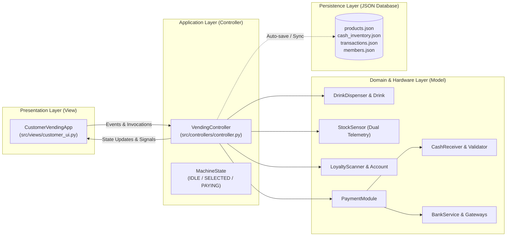

# 🥤 Edge Hill University — Smart Vending Machine System

[](https://www.python.org/)
[](https://docs.python.org/3/library/tkinter.html)
[](https://stripe.com)
[](#-4-system-architecture--how-it-works)
[](#-8-associated-documentation)

An accessible, robust, and touchscreen-optimised **Smart Vending Machine Software System** designed and engineered for the **Software Engineering Group Assignment (CW1)** at **Edge Hill University**.

---

## 📌 Table of Contents
1. [📖 Project Overview](#-1-project-overview)
2. [💻 System Requirements](#-2-system-requirements)
3. [⚙️ Installation & Setup](#-3-installation--setup)
4. [🧠 System Architecture & How It Works](#-4-system-architecture--how-it-works)
   * [MVC Architectural Structure](#41-mvc-architectural-structure)
   * [Cash Handling & Greedy Change Algorithm](#42-cash-handling--greedy-change-algorithm)
   * [Digital Payment Gateways & Stripe Dynamic QR](#43-digital-payment-gateways--stripe-dynamic-qr)
   * [Student & Staff Loyalty Programme](#44-student--staff-loyalty-programme)
   * [Dual-Sensor Inventory Telemetry](#45-dual-sensor-inventory-telemetry)
5. [🕹️ User & Administrator Guide](#-5-user--administrator-guide)
   * [Customer Purchasing Workflow](#51-customer-purchasing-workflow)
   * [Admin & Maintenance Dashboard](#52-admin--maintenance-dashboard)
   * [Keyboard Shortcuts & Navigation Controls](#53-keyboard-shortcuts--navigation-controls)
6. [🎨 UI Design & Accessibility (5-Color Theme)](#-6-ui-design--accessibility-5-color-theme)
7. [📁 Project Structure & JSON Databases](#-7-project-structure--json-databases)
8. [📄 Associated Documentation](#-8-associated-documentation)
9. [👥 Project Credits](#-9-project-credits)

---

## 📖 1. Project Overview

The **Smart Vending Machine System** is an advanced interactive kiosk application simulating a campus-ready smart beverage vending unit. Developed specifically for Edge Hill University, the system bridges touchscreen navigation, hardware-emulated physical numpad keying, real-time student/staff loyalty barcode verification, and a hybrid payment terminal supporting physical UK currency alongside digital online payment gateways.

### 🌟 Key System Capabilities:
* **Flicker-Free Responsive GUI:** High-definition Tkinter interface dynamically centered and scaled according to native display resolution (minimum bounded size: 860x560), complete with dispensing physics animations and synthesized chime acoustics.
* **Strict 5-Color Accessibility Theme:** High-contrast color palette adhering to WCAG AAA contrast standards and Edge Hill University brand identity.
* **Dual-Sensor Telemetry:** Hardware emulation of weight scales (Load Cells) combined with optical beam/proximity sensors for automated inventory discrepancy detection.
* **Greedy Change Dispenser:** Real-time coin vault tracking and an automated greedy algorithm for dispensing optimal change.
* **Dynamic Payment Gateway Engine:** Seamless switching between **Stripe Dynamic QR** (generating live PaymentIntent/Checkout sessions on the fly), **PayPal REST**, **Custom REST**, and an **Offline Mock Bank** test double.
* **Live Maintenance Dashboard:** 6-tab administrator modal featuring a real-time **Live System Summary Sidebar** tracking 8 critical operational metrics.

---

## 💻 2. System Requirements

### Hardware Specifications:
* **Processor (CPU):** 1.6 GHz Dual-Core or faster (x86_64, AMD64, or Apple Silicon M-Series).
* **System Memory (RAM):** 2 GB minimum (4 GB or higher recommended).
* **Storage Capacity:** Minimum 250 MB free disk space.
* **Display Resolution:** Minimum 1024 x 768 (Full HD 1920 x 1080 recommended for optimal kiosk experience).
* **Integrated / USB Webcam (Optional):** 720p or higher (required only for live camera barcode scanning).

### Software & Environment Specifications:
* **Operating System:**
  * macOS (Darwin 11.0 Big Sur or later; verified on macOS Sonoma / Sequoia)
  * Linux (Ubuntu 20.04 LTS+, Debian 11+, Fedora 36+)
  * Microsoft Windows 10 / 11 (64-bit)
* **Python Runtime:** Python **3.9** or higher (fully tested and verified on Python **3.14**).
* **Tkinter Framework:** Standard Tcl/Tk runtime included with official Python distributions.

### Python Dependencies:
| Dependency | Minimum Version | Functional Purpose |
| :--- | :--- | :--- |
| **`Pillow`** | `>= 9.0.0` | High-resolution image resampling, product card artwork rendering, and canvas graphics. |
| **`opencv-python`** | `>= 4.5.0` | Video capture feed processing and dynamic QR code generation (`cv2.QRCodeEncoder`). |
| **`pyzbar`** | `>= 0.1.8` | Real-time optical barcode and QR code decoding from video streams. |
| **`numpy`** | `>= 1.20.0` | Pixel array operations, quiet-zone padding, and nearest-neighbour module scaling. |
| **`stripe`** | `>= 2.60.0` | Stripe API integration for Checkout Sessions, PaymentIntents, and dynamic QR polling. |

---

## ⚙️ 3. Installation & Setup

### 3.1 Clone the Repository
Open a terminal and navigate to your target directory:
```bash
git clone <repository-url>
cd "CW1_Group_Assignment/VendingMachine"
```

### 3.2 Create a Virtual Environment (Recommended)
Isolate dependencies using Python's standard `venv` module:

* **On macOS / Linux:**
  ```bash
  python3 -m venv venv
  source venv/bin/activate
  ```
* **On Windows:**
  ```cmd
  python -m venv venv
  venv\Scripts\activate
  ```

### 3.3 Install Dependencies
Install all required packages from `requirements.txt`:
```bash
pip install -r requirements.txt
```

> [!TIP]
> The primary entry point (`main.py`) includes an **Automated Dependency Verification Engine**. If dependencies are missing when launching the script, the system will detect and attempt to install them via pip automatically before initializing the GUI.

### 3.4 Launch the Application
Run the primary entry point:
```bash
python3 main.py
```

---

## 🧠 4. System Architecture & How It Works

### 4.1 MVC Architectural Structure
The system is architected around a strict **Model-View-Controller (MVC)** design pattern with clean separation of concerns:



* **Presentation Layer (`src/views/`):** Manages the 4 primary full-screen page frames (`catalogue`, `payment`, `success`, `cancelled`), numpad keypad bindings, camera feeds, and the administrative options modal.
* **Controller Layer (`src/controllers/`):** Orchestrates the system state machine (`MachineState`), timer countdowns (60s session limits), sale completion, sale cancellation, and audit logging.
* **Domain Layer (`src/models/`):** Encapsulates core business rules: inventory cataloguing (`DrinkDispenser`), load cell and optical sensors (`StockSensor`), cash validation (`CashValidator`), change dispensing (`ChangeDispenser`), and banking integrations (`BankService`).
* **Persistence Layer (`data/`):** Zero-dependency JSON storage engine allowing instant standalone deployment without requiring external database servers.

---

### 4.2 Cash Handling & Greedy Change Algorithm
The physical cash subsystem is governed by **`CashReceiver`** and its composed **`CashValidator`**:
* **Accepted Denominations (10p to £10.00):**
  * UK Coins: `10p`, `20p`, `50p`, `£1.00 (100p)`, `£2.00 (200p)`
  * UK Banknotes: `£5.00 Note (500p)`, `£10.00 Note (1000p)`
* **Rejection Policy:**
  * Small coins below 10p (`1p`, `2p`, `5p`) and large banknotes (`£20.00`, `£50.00`) are rejected immediately by `CashValidator` and returned through the coin tray without incrementing the inserted balance.
* **Greedy Change Dispenser Algorithm:**
  When a transaction is overpaid, `ChangeDispenser` determines the optimal combination of coins using a greedy strategy descending through available denominations (`£2.00` ➔ `£1.00` ➔ `50p` ➔ `20p` ➔ `10p`). Coin quantities are verified and deducted directly from `data/cash_inventory.json`.

---

### 4.3 Digital Payment Gateways & Stripe Dynamic QR
When the customer chooses card or QR payment:
1. `CardReader` requests a session via `BankService.createCheckoutSession()`.
2. **Stripe Gateway:** Makes a direct REST call to the Stripe API (`api.stripe.com/v1/checkout/sessions`) to generate a dynamic hosted session URL.
3. The URL is encoded into a high-contrast QR code using `cv2.QRCodeEncoder` / `qrcode` with quiet-zone padding and displayed on Page 2.
4. An **Asynchronous Background Polling Thread** queries the gateway session every 1.5 seconds.
5. Once payment is confirmed (`status == "complete"` and `payment_status == "paid"`), the controller completes the sale and triggers dispensing.
6. If the 60-second timer expires or the customer cancels, the session is invalidated immediately via `expireCheckoutSession()`.

---

### 4.4 Student & Staff Loyalty Programme
* Registered university member accounts are maintained in `data/members.json`.
* Customers scan their card via webcam or enter the card ID manually (e.g. `247480103B001`).
* If the account exists and is active, a **10% discount** is applied instantly:
  $$\text{Amount Due} = \text{List Price} \times 0.90$$
* An **Idempotency Guard** ensures the discount can only be applied once per session.

---

### 4.5 Dual-Sensor Inventory Telemetry
To simulate physical vending hardware, the machine employs dual telemetry cross-checking:
1. **Load Cell (Weight Scale):** Measures the total physical weight of the tray:
   $$\text{Tray Weight} = (\text{Stock Count} \times \text{Unit Weight}) + \text{Tare Weight}$$
2. **Optical Beam / Proximity Sensor:** Electronically detects and counts physical cans in the column.
3. If measured weight does not correspond with the optical count (tolerance: 25g), the system flags a `DISCREPANCY_ALERT` on the telemetry dashboard.

---

## 🕹️ 5. User & Administrator Guide

### 5.1 Customer Purchasing Workflow

```
[Page 1: Select Drink] ──► [Page 2: Scan Loyalty & Pay] ──► [Page 3: Collect Drink & Change]
```

1. **Select a Drink (Page 1):**
   * Browse drinks on the interactive grid or filter by category buttons (Coffee, Chocolate & Tea, Cold Drinks).
   * Enter the 2-digit slot code using the physical keyboard or on-screen numpad (e.g. `0`, `1` for Espresso; `0`, `2` for Latte).
   * The selected product card highlights in Electric Lime Green. Click **"Proceed to Payment"**.
2. **Scan Loyalty Card (Page 2 - Optional):**
   * Click **"Turn On Camera"** to present a barcode to the webcam, or enter the card ID manually.
   * If valid, a 10% discount is applied to the amount due immediately.
3. **Complete Payment (Page 2):**
   * **Cash:** Click the coin/banknote insertion buttons (10p to £10). The inserted balance accumulates until the target amount is satisfied. Change is calculated and shown.
   * **Card / QR Code:** Scan the dynamic QR code using a mobile device, or click "Simulate Bank Approval" for test mode.
4. **Collect Product & Change (Page 3):**
   * The system presents a drop-down dispensing animation, an audio chime, and a detailed change receipt breakdown.
   * The system automatically returns to Page 1 after 10 seconds.

---

### 5.2 Admin & Maintenance Dashboard
Click the **"⚙️ Options"** button at the top-right corner of the main screen to open the Maintenance Dashboard:

* **Live System Summary Sidebar:** Displays continuous live telemetry (Controller State, Active Gateway, Timeout limit, Cash/Card enabled flags, Total stock, Vault value, and Loyalty member count). Updates dynamically on every configuration change.
* **Tab 1: Products Catalogue:** Edit drink names, prices, categories, and slot assignments. Restock individual slots or click **"Restock All Slots (+10)"** with automated load cell recalibration.
* **Tab 2: Cash Inventory:** Monitor coins and banknotes in the vault. Click **"Refill All Denominations"** to replenish change reserves.
* **Tab 3: Payment Configuration:** Enable or disable cash and card methods. Switch active gateways (**Stripe**, **PayPal**, **Custom REST**, or **Mock Bank**), test API connectivity, and configure the transaction timeout (5s to 300s).
* **Tab 4: Transactions History:** Inspect timestamped receipts and financial totals with filtering options.
* **Tab 5: Loyalty Members:** Register new card IDs, toggle member active/inactive status, or remove records.
* **Tab 6: System Activity Logs:** View comprehensive audit trails and diagnostic system events.

---

### 5.3 Keyboard Shortcuts & Navigation Controls
* **`0` – `9`:** Input slot digits into the selection pad.
* **`Backspace`:** Clear the entered slot digits.
* **`Enter` / `Return`:** Confirm slot selection and proceed to payment.
* **`Escape (Esc)`:** Cancel the transaction and issue an immediate refund.
* **`MouseWheel / Trackpad Vertical Scrolling`:** Smooth scrolling across Tab 3 (Payment Methods) and Page 2 (Customer Payment).
* **`PageUp` / `PageDown`:** Rapid page jump scrolling in dialogue canvases.

---

## 🎨 6. UI Design & Accessibility (5-Color Theme)

The user interface adheres to a strict 5-color palette providing high contrast and visual clarity:

| Hex Code | Color Name | Swatch | Functional Role in Interface |
| :---: | :--- | :---: | :--- |
| **`#3A0C51`** | **Deep Aubergine Purple** | 🟣 | Primary window canvas, top header, bottom footer, and product card bases. |
| **`#BAEF2D`** | **Electric Lime Green** | 🟢 | Primary Call-to-Action (CTA) buttons, selected slot highlights, price badges. |
| **`#FFFFFF`** | **Pure White** | ⚪ | Primary typography, modal dialog surfaces, high-contrast readable text. |
| **`#D883FF`** | **Bright Lavender Lilac** | 🟪 | Secondary accents, status subtitles, tab active highlights, dividers. |
| **`#12372E`** | **Deep Forest Green** | 🌲 | Digital terminal displays, numpad button backgrounds, sensory telemetry cards. |

---

## 📁 7. Project Structure & JSON Databases

```text
VendingMachine/
├── main.py                     # Primary Application Entry Point (with dependency verification)
├── requirements.txt            # Python Package Dependencies
├── README.md                   # Complete System Documentation
│
├── src/                        # Core Application Source Tree
│   ├── controllers/            # [Controller Layer] State Machine & Coordination
│   │   ├── __init__.py
│   │   └── controller.py       # VendingController & JSON Database I/O
│   │
│   ├── models/                 # [Domain Layer] Business Logic & Hardware Entities
│   │   ├── __init__.py
│   │   ├── inventory.py        # Drink, DrinkDispenser, StockSensor, LoyaltyAccount, LoyaltyScanner
│   │   ├── payment.py          # PaymentModule, CashReceiver, CashValidator, ChangeDispenser, CardReader
│   │   └── bank.py             # BankService Interface, MockBankService
│   │
│   ├── views/                  # [Presentation Layer] User Interface & Hardware Views
│   │   ├── __init__.py
│   │   └── customer_ui.py      # Tkinter GUI (Pages 1-4, Numpad, Admin Options Panel)
│   │
│   └── utils/                  # [Cross-Cutting Layer] Shared Utilities
│       ├── __init__.py
│       ├── timer.py            # TransactionTimer (Countdown & Timeout Engine)
│       └── logger.py           # Logger & TransactionRecord (Audit Trail Engine)
│
├── data/                       # [Persistence Layer] JSON Databases
│   ├── activity_log.json       # System Event & Hardware Diagnostic Logs
│   ├── cash_inventory.json     # Coin & Banknote Quantities & Capacities
│   ├── members.json            # Loyalty Member Accounts & Active Statuses
│   ├── payment_config.json     # Gateway Configurations & Payment Method Toggles
│   ├── products.json           # Product Catalogue, Pricing, Weight & Dimensions
│   └── transactions.json       # Order & Transaction Audit Receipts
│
└── assets/                     # [Static Assets] High-Resolution Product Photos & Logos
    ├── edge_hill_logo.png      # Official Edge Hill University Crest
    └── *.jpg / *.png / *.avif  # Beverage Artwork Assets
```

---

## 📄 8. Associated Documentation

Complete Software Engineering (OOAD) documentation suite for this system:
* **UML Design Specifications:** [uml-diagrams.md](file:///Users/chatchawanjiamprasut/.gemini/antigravity/brain/13fa5075-f274-4566-ad65-387b625d3b6f/uml-diagrams.md) — Comprehensive UML Class Diagram, 2 Sequence Diagrams, State Machine Statechart, and Package Architecture.
* **System Process Flowcharts:** [system-flowcharts.md](file:///Users/chatchawanjiamprasut/.gemini/antigravity/brain/13fa5075-f274-4566-ad65-387b625d3b6f/system-flowcharts.md) — 4 operational flowcharts (Customer Journey, Cash Validation & Greedy Change, Stripe QR Lifecycle, and Maintenance Dashboard Workflow).
* **Software Test Plan (IEEE 829 Standard):** [Software_Test_Plan_Smart_Vending_Machine.docx](file:///Users/chatchawanjiamprasut/Desktop/Year%203/Software%20Engineering/CW1_Group_Assignment/VendingMachine/Software_Test_Plan_Smart_Vending_Machine.docx) — Formal Word document covering 7 test suites across 40+ test cases.

---

## 👥 9. Project Credits
* **Institution:** Edge Hill University — Department of Computer Science
* **Course:** Software Engineering (Year 3) — Group Assignment (CW1)
* **Academic Year:** 2026
